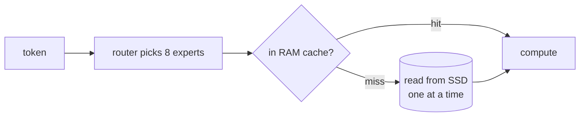
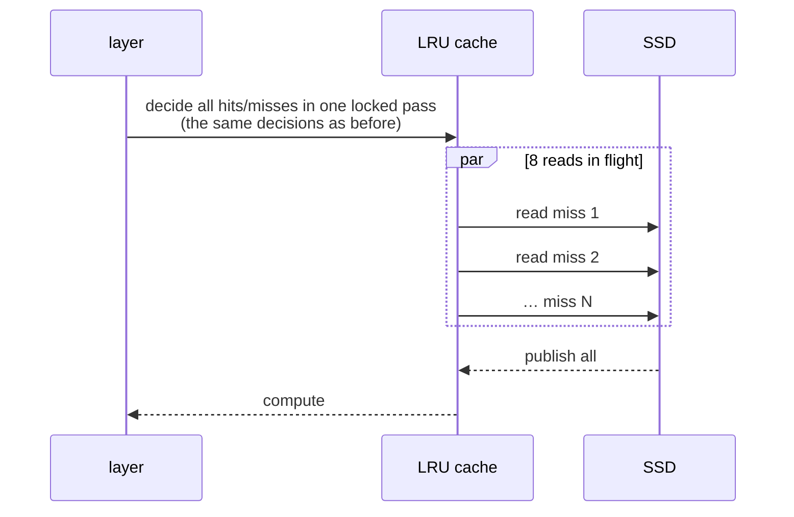
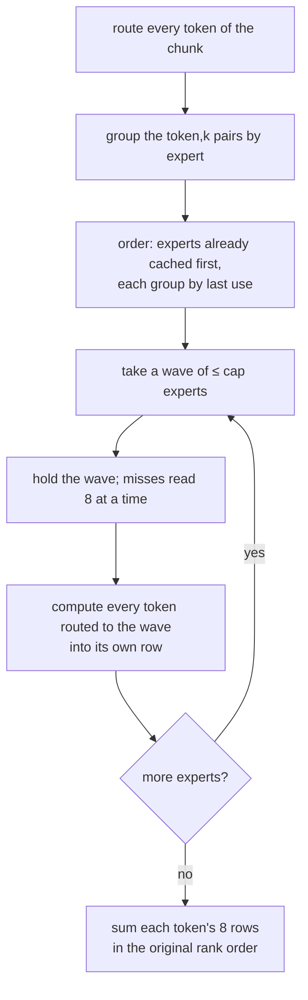

<p align="center">
  
</p>

<p align="center">
  <a href="LICENSE"></a>
  <a href="https://github.com/JustVugg/colibri"></a>
  
  
  
  
</p>

<p align="center">
  <b>Time to first token on a 514-token prompt: 376 s → 30.0 s (-92%) ·
  disk reads 283 GB → 35 GB · output bit-for-bit identical</b>
</p>

<p align="center">
  <a href="#-quick-start">🚀 Quick start</a> ·
  <a href="#-talk-to-the-model">💬 Chat</a> ·
  <a href="#-results">📊 Results</a> ·
  <a href="#-how-it-works">🔬 How it works</a> ·
  <a href="https://raw.githack.com/MostafaaElhadidy/Colibri_Qwen_Optimization/main/docs/colibri_story.html">📖 The story</a> ·
  <a href="docs/colibri_optimization_results.pdf">📄 PDF report</a> ·
  <a href="docs/STATUS.md">🧭 Status</a>
</p>

---

## 💡 What is this?

[**colibri**](https://github.com/JustVugg/colibri) runs very large **Mixture-of-Experts (MoE)** language models on ordinary machines. Each layer of an
MoE model has many small sub-networks, the *experts*, and only a few of them run for each token. colibri keeps a small
**cache** of experts in RAM and streams the rest from the SSD as the model asks for them.

This project is a research fork that measured where that streaming loses time and fixed it. It works on
**Qwen3-Coder-30B-A3B** (48 layers × 128 experts, 8 per token) on colibri's `qwen36` engine, as a stand-in for
**GLM-5.3-Flash**, which does not fit the test machine.

> 🔎 **The finding:** on this machine the time goes to **loading experts from disk**, not to computing with them. Fetching
> experts took 81–94% of every decode step, and processing a prompt re-read the same experts again and again.

### ✨ Highlights

- ⚡ **Parallel miss loading:** a layer's missing experts are read 8 at a time instead of one at a time. Time to first token
  **39–68% faster**, end-to-end tokens/s **+59…+84%**.
- 🌊 **Expert-major prefill ("waves"):** each expert is read **once per prompt** instead of once per token. Time to first token
  **49–92% faster** on top of parallel loading, and **54–88% fewer bytes read** on
  medium and long prompts.
- 🎯 **Exact:** last-token logits are **byte-identical** to the frozen original in all **172** runs of the modified program
  (0 differences).
- 🔍 **Phase 0 attribution:** the "3 million page faults" were load-time and first-touch, not per miss. The real per-miss cost is
  the **Windows host paging the WSL VM out** ([details](#-phase-0-what-the-page-faults-really-were)).
- 🧪 Every claim comes from **cold, interleaved (ABBA), 3-rep** benchmarks with **bootstrap 95% confidence intervals**.
  Results that don't clear the bar are reported as *n.s.*, not as wins.

> 📖 **New here?** Read [**the whole story on one page**](https://raw.githack.com/MostafaaElhadidy/Colibri_Qwen_Optimization/main/docs/colibri_story.html): from the first measurement to the GLM-5.3
> outlook, with interactive charts ([source](docs/colibri_story.html)).

<p align="center">
  
</p>

---

## 📚 Table of contents

- [💡 What is this?](#-what-is-this)
- [🚀 Quick start](#-quick-start)
- [💬 Talk to the model](#-talk-to-the-model)
- [⚙️ Feature flags](#️-feature-flags)
- [📊 Results](#-results)
- [🔬 How it works](#-how-it-works)
- [🔍 Phase 0: what the page faults really were](#-phase-0-what-the-page-faults-really-were)
- [✅ Correctness](#-correctness)
- [🧪 Reproducing the benchmarks](#-reproducing-the-benchmarks)
- [🗂️ What changed in the code](#️-what-changed-in-the-code)
- [🌐 Does it carry over to GLM-5.3-Flash?](#-does-it-carry-over-to-glm-53-flash)
- [⚠️ Limitations and what didn't help](#️-limitations-and-what-didnt-help)
- [🗺️ Roadmap](#️-roadmap)
- [📖 Documentation](#-documentation)
- [🙏 Acknowledgements and references](#-acknowledgements-and-references)
- [📜 License](#-license)
- [📝 Citation](#-citation)

---

## 🚀 Quick start

### 1. Requirements

| | |
|---|---|
| 🐧 OS | Linux, or Windows with WSL2 |
| 🛠️ Toolchain | `gcc` or `clang` with OpenMP, `make`, Python 3 (benchmarks only) |
| 💾 Disk | ~19 GB for the model, an SSD strongly recommended |
| 🧠 RAM | ~3.9 GB at `--cap 12`, ~6.3 GB at `--cap 32` (peak RSS measured) |

### 2. Build

```bash
git clone https://github.com/MostafaaElhadidy/Colibri_Qwen_Optimization.git
cd Colibri_Qwen_Optimization
make -C c qwen36                                        # the Qwen3 / Qwen3-Coder engine
make -C c tests/test_qwen36_cache_index && c/tests/test_qwen36_cache_index   # unit tests
```

### 3. Get the model

```bash
pip install -U "huggingface_hub[cli]"
huggingface-cli download Justvugg/Qwen3-Coder-30B-A3B-colibri-int4 --local-dir ~/colibri-models/qwen3-coder-30b
```

### 4. Run it

The engine reads a prompt file. Qwen3-Coder expects plain ChatML:

```bash
printf '<|im_start|>user\nWrite a Python function that checks whether a string is a valid IPv4 address.<|im_end|>\n<|im_start|>assistant\n' > prompt.txt

# usage: qwen36 <cap: experts cached per layer> <bits> <prompt file>
SNAP=~/colibri-models/qwen3-coder-30b N_NEW=64 \
COLI_Q36_MISS_QD=8 COLI_Q36_PREFILL_WAVES=1 \
OMP_NUM_THREADS=$(nproc) ./c/qwen36 32 4 prompt.txt
```

> 💡 Every optimization is an **environment flag, off by default**. Without the flags you get the original colibri behaviour,
> bit for bit. `COLI_TIMERS=1` prints a per-phase timing breakdown, and `DUMP=logits.f32` writes the last-token logits for
> comparisons.

> ℹ️ For everyday use, colibri's own launcher (`./coli chat`, `./coli serve`) works as usual; see
> [README.colibri.md](README.colibri.md). This fork passes the flags through the environment.

---

## 💬 Talk to the model

Want to chat with Qwen3-Coder yourself, and feel the difference? [`chat.py`](benchmarks/expert_cache_research/chat.py) loads the
model once and keeps the conversation going. Pick the engine when you start it:

```bash
cd benchmarks/expert_cache_research

python3 chat.py original     # 🐢 the original colibri engine
python3 chat.py modified     # ⚡ this project: parallel loading + waves
```

Wait for **`Ready`** (the model takes 1–3 minutes to load), then type after `you ›` and press **Enter**. The answer streams in
after `model ›`, and a timing line follows it:

```text
you › Write a one-line Python function that reverses a string.
model › def reverse_string(s): return s[::-1]

   ⏱  first token after 24.5 s · 14 tokens in 44.7 s (0.69 tok/s) · prompt 20 tokens
```

| Command / option | What it does |
|---|---|
| `/reset` | start a new conversation |
| `/quit` or **Ctrl + C** | exit |
| `--max-tokens N` | longest answer, default 512 |
| `--cap N` | experts kept in RAM per layer, default 12 (`--cap 32` is faster if you have ~6.5 GB free) |
| `--temp T` | sampling temperature, default 0 (deterministic) |

> 🔬 **Try the same long message in both.** Paste a page of code and ask *"explain this code"*: the longer the message, the
> bigger the gap in *first token after*, because the original re-reads the same experts for every token of your message.
> With the default temperature 0, both engines give the **same answer**; only the waiting changes.

> ℹ️ Why not `coli chat`? colibri's launcher applies the Qwen3.6 template to this model, adding an empty `<think></think>`
> block, and Qwen3-Coder then answers with nothing. `chat.py` sends plain ChatML instead. The engine's own diagnostics go to
> `/tmp/colibri_chat_<engine>.log`, so the chat stays clean. Run one chat at a time.

---

## ⚙️ Feature flags

All flags live in [`c/qwen36.c`](c/qwen36.c). **All are off unless set.**

| Flag | Default | What it does | Verdict |
|---|---|---|---|
| `COLI_Q36_MISS_QD=N` | `0` (off) | Read a layer's cache misses `N` at a time (same cache decisions as the original) | ✅ use `8` |
| `COLI_Q36_PREFILL_WAVES=1` | off | Expert-major prefill: route the whole chunk, then load each distinct expert once, in waves no larger than the cache | ✅ big TTFT win |
| `COLI_Q36_PREFILL_WAVES_CHUNK=N` | `0` = whole chunk | Tokens planned into waves at once (smaller = less memory, more re-reads) | keep `0` |
| `COLI_Q36_PREFILL_WAVES_HEADROOM=H` | `1` with PILOT, else `0` | Cache slots kept out of a wave | default |
| `COLI_Q36_PREFILL_WAVES_ORDER=first` | `last` | `last` (default) leaves decode with exactly the original's cache; `first` = first-seen order | default |
| `COLI_Q36_PREFILL_GROUPED=1` | off | Exact 4-token kernel per weight pass inside waves | ➖ compute −9…−17%, TTFT n.s. |
| `COLI_Q36_SLOT_ARENA=1` | off | Expert cache in 2 MiB huge pages, one mapping per layer | ➖ fewer faults, no speed-up |
| `COLI_Q36_FAULT_PROF=1` | off | Diagnostic: page faults and time for each step of a cache miss | 🔍 diagnostics |

---

## 📊 Results

> 🧪 **Protocol.** Every run is **cold**: a fresh process with the OS page cache emptied, checked with `mincore`. Variants run
> back to back in **ABBA** order, 3 repetitions each, with identical model, cache size, prompts and settings. **Δ** is the
> change of the mean, and the brackets are a **bootstrap 95% CI**. *n.s.* means the interval includes 0. Machine: i9-14900HX
> laptop, NVMe, WSL2 limited to 12 GB of a 16 GB host. Model: Qwen3-Coder-30B-A3B int4 (19 GB).

### ⚡ Parallel miss loading: original vs `COLI_Q36_MISS_QD=8`

| Prompt, cache | Time to first token | Δ | Tokens/s, end to end | Δ |
|---|---|---|---|---|
| short (24 tok), cap 32 | 59.8 → 29.3 s | **-51%** [-58, -42] | 0.31 → 0.52 | **+66%** [+32, +111] |
| medium (161 tok), cap 32 | 131 → 79.9 s | **-39%** [-48, -26] | 0.20 → 0.31 | **+59%** [+25, +96] |
| short (24 tok), cap 12 | 52.6 → 17.0 s | **-68%** [-82, -37] | 0.46 → 0.85 | **+84%** [+32, +210] |
| medium (161 tok), cap 12 | 135 → 74.6 s | **-45%** [-46, -43] | 0.18 → 0.32 | **+80%** [+70, +90] |

### 🌊 Waves: `MISS_QD=8` vs `MISS_QD=8` + `COLI_Q36_PREFILL_WAVES=1`

| Prompt, cache | Time to first token | Δ | GB read | Experts read | Tokens/s, end to end | Decode tokens/s |
|---|---|---|---|---|---|---|
| short (24 tok), cap 32 | 40.8 → 20.9 s | **-49%** [-68, -7] | 21.0 → 20.3 | 6,629 → 6,289 | +12% *(n.s.)* | -15% *(n.s.)* |
| medium (161 tok), cap 32 | 82.8 → 27.2 s | **-67%** [-74, -58] | 50.5 → 23.3 | 18,843 → 7,432 | **+72%** [+35, +110] | -28% [-48, -1] ⚠️ worse |
| long (514 tok), cap 32 | 221 → 47.0 s | **-79%** [-85, -71] | 141 → 25.8 | 56,703 → 8,363 | **+186%** [+131, +250] | -8% *(n.s.)* |
| short (24 tok), cap 12 | 24.3 → 9.0 s | **-63%** [-75, -44] | 32.9 → 27.6 | 11,658 → 9,377 | +58% *(n.s.)* | +20% *(n.s.)* |
| medium (161 tok), cap 12 | 117 → 18.0 s | **-85%** [-89, -77] | 102 → 32.2 | 40,440 → 11,203 | **+252%** [+102, +452] | +51% *(n.s.)* |
| long (514 tok), cap 12 | 376 → 30.0 s | **-92%** [-94, -90] | 283 → 34.8 | 116,777 → 12,261 | **+571%** [+407, +794] | +48% *(n.s.)* |

<details>
<summary>📐 <b>Planning window</b>: how many tokens to plan into waves at once (514-token prompt, 2 cold runs)</summary>

| Tokens planned at once | cap 32: GB read | first token (s) | cap 12: GB read | first token (s) |
|---|---|---|---|---|
| 32 | 86.3 | 239 | 121.0 | 221 |
| 64 | 64.8 | 231 | 87.5 | 154 |
| 128 | 47.0 | 157 | 62.3 | 115 |
| 256 | 33.8 | 115 | 45.9 | 56 |
| whole prompt (514) | 25.9 | 68 | 35.1 | 53 |

Bigger is strictly better: fewer re-reads, while expert compute stays at 9–17 s at every size.
</details>

<details>
<summary>🔁 <b>Wave order</b>: decode misses after prefill (deterministic)</summary>

| Prompt, cache | original path | waves, first-seen order | waves, last-use order (default) |
|---|---|---|---|
| short (24 tok), cap 32 | 3,271 | 3,441 | **3,271** |
| medium (161 tok), cap 32 | 1,870 | 2,532 | **1,870** |
| long (514 tok), cap 32 | 2,164 | 2,756 | **2,164** |
| short (24 tok), cap 12 | 6,383 | 6,529 | **6,383** |
| medium (161 tok), cap 12 | 6,053 | 6,303 | **6,053** |
| long (514 tok), cap 12 | 6,410 | 6,654 | **6,410** |

Last-use order leaves decode with exactly the original's cache in every cell.
</details>

<details>
<summary>🧮 <b>Grouped kernel</b> (<code>COLI_Q36_PREFILL_GROUPED=1</code>): exact, but not worth enabling here</summary>

| Prompt, cache | Expert compute in prefill | Δ time to first token |
|---|---|---|
| medium (161 tok), cap 32 | 4.7 → 4.9 s | 0% *(n.s.)* |
| long (514 tok), cap 32 | 10.1 → 8.4 s | 0% *(n.s.)* |
| medium (161 tok), cap 12 | 3.7 → 3.3 s | **+58%** [+11, +126] ⚠️ worse |
| long (514 tok), cap 12 | 8.5 → 7.8 s | -3% *(n.s.)* |

The kernel shares each weight load across 4 tokens while keeping each token's arithmetic order, so the output is identical.
Compute is only 10 s of a 49.8 s first token on this machine, so it does not move time to first token.
</details>

Full tables with every metric (misses, faults, RSS, CPU time) are in
[`docs/expert_cache_research_2.md`](docs/expert_cache_research_2.md) and in
`benchmarks/expert_cache_research/*/comparison*.md`.

---

## 🔬 How it works

### The original path



A prompt of *S* tokens needs *S × 8* experts per layer. When that exceeds the cache (`cap`), colibri processes **one token at
a time**, and each token re-reads experts the previous ones evicted. The 514-token prompt read
**116,777 experts (283 GB)** at cap 12 for a model that has only 48 × 128 = 6,144.

### ⚡ Parallel miss loading (`COLI_Q36_MISS_QD`)



The SSD delivers 4.0× more at 8 reads in flight than at one (`env/expert_iobench.json`). Hits, misses and evictions are identical to the original.

### 🌊 Expert-major prefill ("waves", `COLI_Q36_PREFILL_WAVES`)



**Why the output stays identical.** In colibri's expert kernel (`c/expert_ffn.h`), a (token, expert) output depends only on
that token's row and that expert. So computing it in a different batch gives the same bits. The final per-token sum
(`xf_moe_combine`) is the same statement, in the same order, as the original `xf_moe_add`.

---

## 🔍 Phase 0: what the page faults really were

The first study saw ~3.0 M minor page faults per short run and suspected a per-miss overhead. Instrumenting every step
of a miss (`COLI_Q36_FAULT_PROF=1`) showed otherwise:

| Phase | Minor faults |
|---|---|
| 🏗️ model load | 2,025,231 |
| 📝 prompt (first touch of the expert cache's memory: 48 layers × 32 slots × 648 pages) | 995,289 |
| 💬 decode (all misses into reused memory) | **0** |

The real per-miss costs are:
1. 📖 a **second disk read** per expert for its scales, which the file stores apart from the weights (2.0 ms);
2. 🪟 rewriting an evicted slot takes 3.0 ms, against 0.28 ms for fresh memory. During a run the
   **Windows host fell to 4 MB free** and pushed the VM down to 876 MB of real memory while the engine held
   4,157 MB. The least recently used slot is exactly what the host paged out.

The fix for (2) is in the environment, not the engine: give WSL less RAM than the host can actually back.

---

## ✅ Correctness

- 🔒 **Byte-identical logits.** `DUMP=` writes the last-token logits, and `check_correctness.py` compares their SHA-256 and the
  generated text against the **frozen original binary** (colibri commit `e0db083c`): **172 runs, 0 differences**,
  across every variant, prompt length and cache size, with every flag off and on.
- 🧩 **Unit tests** (`c/tests/test_qwen36_cache_index`) check:
  - the batched loader makes the same decisions as the serial one;
  - waves are bit-identical to the token path in 13 configurations;
  - every (token, expert) pair is computed exactly once, and no expert is read twice in a layer pass.
- 🎲 **Deterministic cache decisions.** Hit and miss counts are identical across repetitions of each variant.

---

## 🧪 Reproducing the benchmarks

Everything is in [`benchmarks/expert_cache_research/`](benchmarks/expert_cache_research/README.md): the harness, the scripts,
the commands of every session, and the per-run results (`runs.jsonl`).

```bash
cd benchmarks/expert_cache_research
# one cold run by hand
python3 evict_cache.py ~/colibri-models/qwen3-coder-30b && \
  SNAP=~/colibri-models/qwen3-coder-30b N_NEW=32 COLI_TIMERS=1 COLI_LOOKUP=0 OMP_NUM_THREADS=16 \
  DUMP=/tmp/l.f32 ../../c/qwen36 32 4 prompts/rendered/short.txt

# the main A/B (cold, ABBA, 3 reps): see ab2/commands.txt
bash -c "$(grep -v '^#' ab2/commands.txt)"
python3 summarize.py ab2/waves && python3 compare.py ab2/qd8 ab2/waves --out ab2/comparison_waves.md
python3 check_correctness.py ab2/baseline ab2/qd8 ab2/waves     # must print 0 failure(s)
```

> ⏱️ A cold short run takes ~1–2 min. The 514-token prompt takes 5–8 min without waves. The full matrix takes a few hours.

---

## 🗂️ What changed in the code

| File | Change |
|---|---|
| [`c/qwen36.c`](c/qwen36.c) | batched miss loading, prefill waves, slot arena, fault profiler; all behind flags |
| [`c/expert_ffn.h`](c/expert_ffn.h) | `xf_moe_combine` (rank-order sum), exact 4-token `xf_dot_i8_x4`, `xf_moe_compute_ex` |
| [`c/tests/test_qwen36_cache_index.c`](c/tests/test_qwen36_cache_index.c) | batch-vs-serial and waves-vs-token-path tests |
| [`benchmarks/expert_cache_research/`](benchmarks/expert_cache_research/) | benchmark kit and all results |
| [`docs/`](docs/) | reports (part 1, part 2), PDF, status, report builders |

---

## 🌐 Does it carry over to GLM-5.3-Flash?

`c/glm53.c` already reads a layer's misses in parallel and processes prompts expert by expert, inside a **128-token window**.
Three pieces would carry over:
- **cached experts first**;
- a **larger planning window**;
- a **fixed-order sum**, so the reordering stays bit-exact (glm53 adds results in block order).

> 📐 **Estimate, not a measurement.** On Qwen, a 128-token window read 1.8× the bytes of whole-prompt planning on the
> 514-token prompt. If GLM-5.3 behaves alike, prefill expert reads would fall by roughly **44–45%** on
> ~500-token prompts. GLM-5.3 has different expert counts, sizes and routing, so this **must be measured on the target machine**.

---

## ⚠️ Limitations and what didn't help

- 🪟 **The machine.** WSL2 on a memory-starved 16 GB host: absolute times drift between sessions, so only interleaved comparisons
  are used.
- 📉 **Decode speed is not proven to change**: 3 repetitions cannot resolve it under this noise.
- 🧱 **Huge-page arena:** faults -11…-34%, but 17/18 timing comparisons n.s., and +1–3% RSS.
- 🧮 **Grouped kernel:** exact and faster at compute, but TTFT n.s. here.
- 🧊 **Cold check:** 26 of 176 runs started with up to 4.3 MB (of 19 GB) still cached (negligible, but not
  exactly 0).
- 🚫 **Not measured:** server (warm) mode, PILOT prefetch together with waves, and the GPU (CUDA/Vulkan) paths, which keep the
  original code path.

---

## 🗺️ Roadmap

- [x] Parallel miss loading (`COLI_Q36_MISS_QD`)
- [x] Attribute the per-miss overhead (Phase 0)
- [x] Expert-major prefill, bit-exact (`COLI_Q36_PREFILL_WAVES`)
- [x] Last-use wave order as the default
- [x] Exact grouped kernel (`COLI_Q36_PREFILL_GROUPED`)
- [ ] Port cached-first waves, a fixed-order sum and a larger window to `glm53.c`, and measure on the target machine
- [ ] Re-measure decode on a host with spare RAM (≥ 6 repetitions)
- [ ] One disk read per expert (merge or overlap the scale read)
- [ ] Decide whether waves should be on by default

---

## 📖 Documentation

| Document | What's in it |
|---|---|
| 📖 [**The story** (view)](https://raw.githack.com/MostafaaElhadidy/Colibri_Qwen_Optimization/main/docs/colibri_story.html) · [`docs/colibri_story.html`](docs/colibri_story.html) | everything that happened, in order, on one interactive page: the original engine, each change, the proof, and GLM-5.3 |
| 📄 [`docs/colibri_optimization_results.pdf`](docs/colibri_optimization_results.pdf) | 5-page summary for a technical reader new to colibri |
| 🧭 [`docs/STATUS.md`](docs/STATUS.md) | where things stand, every flag, next steps |
| 📘 [`docs/expert_cache_research.md`](docs/expert_cache_research.md) | part 1: architecture, baseline, parallel loading |
| 📗 [`docs/expert_cache_research_2.md`](docs/expert_cache_research_2.md) | part 2: Phase 0, waves, all studies |
| 🧰 [`benchmarks/expert_cache_research/README.md`](benchmarks/expert_cache_research/README.md) | benchmark kit |
| 🐦 [`README.colibri.md`](README.colibri.md) | the upstream colibri README (all engines, the `coli` launcher, the GPU backends) |

The README, the PDF and the story page are generated from the result files: `python3 docs/report_src/build_readme.py`,
`python3 docs/report_src/build_report.py` and `python3 docs/report_src/build_story.py`.

---

## 🙏 Acknowledgements and references

- 🐦 **[colibri](https://github.com/JustVugg/colibri)** by **Vincenzo Fornaro (JustVugg)**, the engine this work is built on. All credit for the engine, the
  model conversions and the original expert cache goes to colibri and its contributors. Please star and support the
  original project.
- 🤖 **[Qwen3-Coder](https://github.com/QwenLM/Qwen3-Coder)** by the Qwen team; the int4 colibri conversion is
  [`Justvugg/Qwen3-Coder-30B-A3B-colibri-int4`](https://huggingface.co/Justvugg/Qwen3-Coder-30B-A3B-colibri-int4).
- 📚 Related work on MoE expert offloading that informed the design:
  [MoE-Infinity](https://arxiv.org/abs/2401.14361) ·
  [ProMoE](https://arxiv.org/abs/2410.22134) ·
  [HOBBIT](https://arxiv.org/abs/2411.01433) ·
  [Fiddler](https://arxiv.org/abs/2402.07033) ·
  [HybriMoE](https://arxiv.org/abs/2504.05897) ·
  [SpecMD](https://arxiv.org/abs/2602.03921)

---

## 📜 License

Licensed under the **Apache License 2.0**, the same as colibri. See [`LICENSE`](LICENSE) and [`NOTICE`](NOTICE).

- colibri is © 2026 Vincenzo Fornaro.
- The modifications in this repository are © 2026 Mostafa Elhadidy, under the same license. They are listed in `NOTICE` and in
  the git history.
- Third-party components bundled with colibri are listed in [`THIRD_PARTY_NOTICES.md`](THIRD_PARTY_NOTICES.md).

---

## 📝 Citation

If you use this work, please cite it, and cite colibri (see [`CITATION.cff`](CITATION.cff)):

```bibtex
@software{elhadidy2026colibri_qwen_opt,
  author  = {Elhadidy, Mostafa},
  title   = {Colibri × Qwen3-Coder: faster expert loading for Mixture-of-Experts inference},
  year    = {2026},
  url     = {https://github.com/MostafaaElhadidy/Colibri_Qwen_Optimization},
  note    = {Built on colibri by Vincenzo Fornaro, https://github.com/JustVugg/colibri}
}
```

<p align="center">
  Made with ☕ and many cold-cache benchmarks by <a href="https://github.com/MostafaaElhadidy">Mostafa Elhadidy</a> ·
  powered by <a href="https://github.com/JustVugg/colibri">colibri</a> 🐦
</p>
